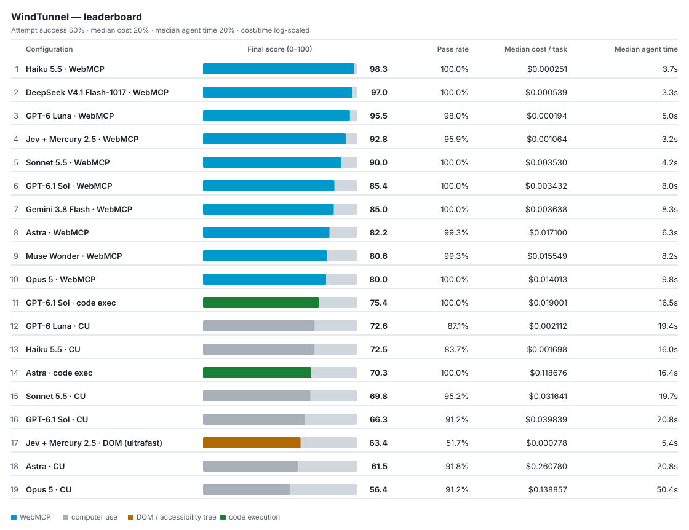

<div align="center">

<picture>
  <source media="(prefers-color-scheme: dark)" srcset="assets/logo-dark.svg">
  
</picture>

# WindTunnel

**Benchmark WebMCP against other methods browser agents use to interact with websites.**

**WebMCP solves 48-49 of 49 tasks, with 3.1× faster median execution and 9× lower median cost than other methods.**

[Quick start](#quick-start) · [Results](#results) · [Run data](results/) · [Methodology](docs/SPEC.md) · [Cost](#cost) · [WebMCP spec](https://github.com/webmachinelearning/webmcp)

[](LICENSE)
[](tasks/)
[](https://github.com/webmachinelearning/webmcp)
[](https://github.com/nekuda-ai/WindTunnel/actions/workflows/test.yml)
[](#results)

</div>

**WindTunnel compares WebMCP with other ways browser agents interact with
websites.** It runs the same tasks on the same sites and measures success rate,
execution time, token usage, and cost.

## Quick start

Just want the results? [Jump to them.](#results)

Run the harness for free (Node 20.11+, no key, no Docker):

```bash
npm ci
WT_FAKE_LIFECYCLE=1 npm run bench    # no LLM — scores 0/7 by design, just proves it runs
```

Run the real benchmark — needs Docker, Linux or macOS, and a key
([setup](#running-it-yourself)):

```bash
npx playwright install chromium
export ANTHROPIC_API_KEY=sk-ant-...
npm run bench -- --arms wm-claude,cu-claude --budget 2
```

Runs the 7 tasks on the three lightweight sites once each, same model on two
interfaces — WebMCP against screenshots. 14 attempts, well under $1; `--budget`
stops launching further attempts once accumulated spend exceeds it.

## Background: Four ways to operate a website

A browser agent can operate a website through four main interfaces:

1. **Screenshots (computer use)** — it reads rendered images of the page and
   acts by coordinate.
2. **Page structure** — it reads the page's DOM and accessibility tree.
3. **Code execution** — the model writes browser-automation code (Playwright)
   that reads and drives the page; OpenAI's recommended mode for GPT-6 Astra.
4. **WebMCP** — the website exposes direct actions (`add_to_cart(id)`,
   `book_slot(time)`) for the agent to call.
   ([What is WebMCP?](https://github.com/webmachinelearning/webmcp))

## Results

**Canonical board v1.3: 2026-10-15** - 18 configurations × 49 tasks across eight
sites × three attempts = **2,646 attempts** and **882 majority verdicts**, with
a 600s per-attempt cap. Changes: [CHANGELOG.md](CHANGELOG.md).

**Haiku 5.5 takes first place** on the combined success, cost, and speed score:
147/147 attempts passed, $0.000251 and 3.7s per median attempt. Eight of the nine
WebMCP configurations solve 49/49 tasks; GPT-6 Luna solves 48/49. Both
code-execution configurations also solve 49/49.

<picture>
  <source media="(prefers-color-scheme: dark)" srcset="assets/charts/balanced-leaderboard-dark.svg">
  
</picture>

<sub>Regenerate with `node scripts/readme-charts.mjs`.</sub>

Canonical artifacts: [CSV](results/canonical/results.csv),
[run JSON](results/canonical/run.json), [provenance](results/canonical/PROVENANCE.md),
and [interactive explorer](results/canonical/explorer.html).

| Configuration | Interface | Solved | Attempts | Turn-cap | Median cost | Median tokens | Median s |
|---|---|---:|---:|---:|---:|---:|---:|
| Haiku 5.5 | WebMCP | 49/49 | 147/147 | 0 | $0.000251 | 5,153 | 3.7 |
| GPT-6 Luna | WebMCP | 48/49 | 144/147 | 0 | $0.000194 | 2,525 | 5.0 |
| Jev + Mercury 2.5 | WebMCP | 49/49 | 141/147 | 0 | $0.001064 | 9,793 | 3.2 |
| Sonnet 5.5 | WebMCP | 49/49 | 147/147 | 0 | $0.003530 | 5,046 | 4.2 |
| GPT-6.1 Sol | WebMCP | 49/49 | 147/147 | 0 | $0.003432 | 2,502 | 8.0 |
| Gemini 3.8 Flash | WebMCP | 49/49 | 147/147 | 0 | $0.003638 | 3,799 | 8.3 |
| GPT-6 Astra | WebMCP | 49/49 | 146/147 | 0 | $0.017100 | 2,575 | 6.3 |
| Muse Wonder | WebMCP | 49/49 | 146/147 | 1 | $0.015549 | 5,236 | 8.2 |
| Claude Opus 5 | WebMCP | 49/49 | 147/147 | 0 | $0.014013 | 4,770 | 9.8 |
| GPT-6.1 Sol | Code execution | 49/49 | 147/147 | 0 | $0.019001 | 10,503 | 16.5 |
| GPT-6 Luna | Computer use | 41/49 | 128/147 | 9 | $0.002112 | 21,177 | 19.4 |
| Haiku 5.5 | Computer use | 41/49 | 123/147 | 0 | $0.001698 | 37,601 | 16.0 |
| GPT-6 Astra | Code execution | 49/49 | 147/147 | 0 | $0.118676 | 10,982 | 16.4 |
| Sonnet 5.5 | Computer use | 47/49 | 140/147 | 3 | $0.031641 | 37,339 | 19.7 |
| GPT-6.1 Sol | Computer use | 45/49 | 134/147 | 14 | $0.039839 | 20,797 | 20.8 |
| Jev + Mercury 2.5 | DOM (ultrafast) | 25/49 | 76/147 | 19 | $0.000778 | 13,892 | 5.4 |
| GPT-6 Astra | Computer use | 45/49 | 135/147 | 11 | $0.260780 | 20,560 | 20.8 |
| Claude Opus 5 | Computer use | 45/49 | 134/147 | 27 | $0.138857 | 47,141 | 50.4 |

<sub>Tasks are solved by a majority of three attempts. Medians include failed
attempts and exclude infrastructure errors. Time is agent time, excluding setup
and reset. Tokens include uncached input, cache reads, cache writes and output.
Historical Opus 5 cache-write tokens were under-recorded; its recorded costs are
preserved.</sub>

**WebMCP is 3.1× faster and 9× cheaper at the median.** These compare the median
WebMCP configuration with the median configuration using another interface;
each configuration has equal weight. Composite scores weight attempt success
60%, log-normalized cost 20%, and log-normalized agent time 20%.

**Turn-cap hits:** 1/1,323 WebMCP attempts versus 83/1,323 other-interface
attempts. Across the six same-model WebMCP/computer-use pairs, the counts are
0 versus 64 out of 882 attempts on each side. Interface-specific turn budgets
remain in force.

## How it works

Every task runs on the same site, from the same seeded state, scored by the
same check, for every method — so a difference in outcome isn't the site or the
data. What differs is the whole method configuration: interface, model,
framework, and turn budget.

- **Real, self-hosted applications.** Production open-source apps, not
  synthetic pages. Each runs locally in Docker, pinned to a fixed version.
- **Outcome-based scoring.** No human or model judges a run: WindTunnel
  inspects the resulting application state — is the item in the cart, does the
  appointment exist — and records pass or fail, plus what the attempt cost.
- **Integrity.** Checked values are generated fresh from a seed, state-changing
  tasks are scored by inspecting the application, and published final answers are redacted. The Jev release includes
  [redacted transcripts](results/2026-09-18-jev-mercury/PROVENANCE.md); the combined result rows stay compact. Memorization risk and its limits:
  [`docs/SPEC.md`](docs/SPEC.md).
- **Earlier scorer correction (v1.0).** Independent review found that the canonical merge had
  been built before corrected predicates were applied. Re-scoring fixed 19
  false negatives — 19 promotions and 0 demotions — and the corrected rows are
  marked in the canonical CSV.

## The sites

Eight applications across public and authenticated pages and different stacks —
six live targets, two read-only controls.

| Site | Type | Pulled from (upstream) | Exercises |
|---|---|---|---|
| nextjs-starter-medusa | online store | [medusajs/nextjs-starter-medusa](https://github.com/medusajs/nextjs-starter-medusa) | browse → cart → checkout |
| hi-events | events / ticketing | [HiEventsDev/Hi.Events](https://github.com/HiEventsDev/Hi.Events) | browse → ticket checkout |
| easyappointments | appointment booking | [alextselegidis/easyappointments](https://github.com/alextselegidis/easyappointments) | booking; admin (auth) |
| learnhouse | course platform | [learnhouse/learnhouse](https://github.com/learnhouse/learnhouse) | catalog; authoring (auth) |
| idurar-erp-crm | B2B CRM | [idurar/idurar-erp-crm](https://github.com/idurar/idurar-erp-crm) | record CRUD (auth) |
| directory-9d8 | business directory | [9d8dev/directory](https://github.com/9d8dev/directory) | search / filter |
| tailwind-nextjs-blog | blog (control) | [timlrx/tailwind-nextjs-starter-blog](https://github.com/timlrx/tailwind-nextjs-starter-blog) | read-only content |
| bulletproof-react | web app (control) | [alan2207/bulletproof-react](https://github.com/alan2207/bulletproof-react) | read-only; auth |

## The tasks

49 benchmark tasks across the eight sites, plus 10 calibration tasks for cost
measurement. Four difficulty tiers by journey length:

| Tier | Steps | Example |
|---|---|---|
| Answer | 1–2 | "What is the price of X?" |
| Action (short) | 3–5 | "Add two of X to the cart." |
| Action (long) | 6–10 | "File a ticket, assign it, set its priority from the report." |
| Sensitive action | 8–15 | "Book the cheapest available slot and confirm." |

Each task is attempted N times (3 by default). A task is **solved** when a
majority of attempts pass; the headline is solved ÷ total, reported next to
median time, tokens, and cost.

Each task also carries a per-interface turn budget — a screenshot agent needs
~3 turns per step, a tool-calling agent ~1 (defaults: [`docs/SPEC.md`](docs/SPEC.md)).

## The methods

The board has 18 configurations: nine with WebMCP and nine using screenshots,
DOM controls, or code execution. Models are Haiku 5.5, Sonnet 5.5, Opus 5,
GPT-6 Luna, GPT-6.1 Sol, GPT-6 Astra, Gemini 3.8 Flash, Muse Wonder, and
Jev + Mercury 2.5. Every configuration uses the same 49 tasks and scoring.

Jev makes decisions; Mercury writes arguments or field values and the final answer.
The WebMCP and ultrafast page setups use separate frozen harnesses, so this is a
comparison of complete setups. Their [runner code and run instructions](experiments/jev/README.md) are published separately from the standard CLI.
[Versions, accounting and redacted transcripts](results/2026-09-18-jev-mercury/PROVENANCE.md).

## Cost

**Where the tokens go.** How much an agent reads each turn is set by the
interface:

- **Screenshots (computer use)** — a full page *image* every turn: thousands of
  tokens each, refreshed nearly every step.
- **Page structure (DOM / accessibility tree)** — the page's *text* every turn,
  the whole page re-read each step. DOM + vision sends the text *and* a
  screenshot, and is often the heaviest configuration of all.
- **WebMCP** — a short list of tool schemas plus small JSON results. No page
  text, no screenshots. Usually less context.

**Per-attempt medians** across the current board:

| Interface | Configurations | Median tokens | Median cost |
|---|---:|---:|---:|
| WebMCP | 9 | 2,502–9,793 | $0.000194–$0.017100 |
| Code execution | 2 | 10,503–10,982 | $0.019001–$0.118676 |
| Computer use | 6 | 20,560–47,141 | $0.001698–$0.260780 |
| DOM (ultrafast) | 1 | 13,892 | $0.000778 |

The current board contains **$173.50 in recorded attempt costs**, including retained
measurements. This excludes smokes, discarded infrastructure attempts and
provider diagnostics; it is not the total campaign bill. Costs use recorded
usage and rates at measurement time.

**Spending less.** The levers, cheapest first:

- **Fewer sites** — `--sites lite` (3 lightweight sites, no databases).
- **Fewer / cheaper methods** — WebMCP medians start at $0.000194 per attempt;
  computer use and DOM + vision carry most of the cost.
- **Fewer attempts** — `--preset smoke` or `--n 1` instead of the default 3
  (you lose majority voting, so one run decides each task).

## Running it yourself

**Setup.** You need Docker, Node 20.11+, and an API key for the model under test:

```bash
npm install
npx playwright install chromium                       # browser for the agents (or set WT_CHROME)
python3 -m venv .venv-browseruse \
  && .venv-browseruse/bin/pip install browser-use==0.12.7   # only for the dom-browseruse method
```

Real site boots use Linux-oriented capsule tooling. Native Linux is the
lowest-overhead host; macOS works through Docker Desktop when GNU tar and
coreutils are installed and placed first on `PATH` (`brew install gnu-tar
coreutils`). Docker Desktop's VM and filesystem layer add boot/reset and
wall-clock overhead, so report the host and avoid comparing absolute latency
with bare-metal Linux. You can also dry-run the pipeline
(`WT_FAKE_LIFECYCLE=1`) or point it at a site you booted yourself
(`WT_MANUAL_BASEURL=http://localhost:PORT`).

**Site profiles** size the run to the machine at hand:

| profile | sites | needs | runs on |
|---|---|---|---|
| `lite` | 3 lightweight sites, no databases | Node | laptop, CI |
| `core` | `lite` + the online store | + Postgres | 8 GB laptop |
| `categories` | one site per category | mixed | 16 GB machine |
| `full` | all 8 sites | all stacks | 16 GB+ worker |

**Commands.** `--arms` picks the methods; the default (`scripted`) is a free,
no-LLM baseline that only exercises the pipeline:

```bash
npm run bench -- --preset smoke --sites lite --arms scripted    # free pipeline check, no API key
npm run bench -- --preset smoke --sites lite --arms wm-claude,cu-claude   # cheapest paid run, 1 attempt per task
npm run bench -- --preset lite --sites lite --arms wm-claude,cu-claude,dom-browseruse,a11y-stagehand   # every task on the three lite sites × 3 attempts
npm run bench -- --preset smoke --sites lite --arms wm-claude --seed 7 --budget 2 --label check
npm run bench -- --preset smoke --sites idurar-erp-crm --arms cu-openai --task-ids id-6,id-6,id-8 --n 1
```

**Keys.** Runs read the provider key straight from your environment:

```bash
export ANTHROPIC_API_KEY=sk-ant-...   # cu-claude, dom-browseruse, a11y-stagehand, wm-claude, wm-stagehand
export OPENAI_API_KEY=sk-...          # cu-openai, wm-gpt, code-openai
export GEMINI_API_KEY=...             # cu-gemini, wm-gemini
export MODEL_API_KEY=...              # wm-meta (Muse Wonder)
export WT_SECRET=...                  # optional capsule secret
export WT_SECRET_KEY=...              # optional key used to protect it
```

A method whose key is absent is skipped with a notice, never an error.
`--task-ids` selects exact task IDs; repeated IDs intentionally repeat a task,
which is useful for targeted diagnostics.

**Switching models.** `--model <method>=<model>` overrides the model for one
method:

```bash
npm run bench -- --preset lite --sites lite --arms wm-claude --model wm-claude=claude-opus-5
npm run bench -- --preset smoke --sites lite --arms cu-openai,wm-gpt,code-openai --model cu-openai=gpt-6-astra --model wm-gpt=gpt-6-astra --model code-openai=gpt-6-astra
```

Muse Wonder is measured through the direct Meta API on `wm-meta`; computer
use is not included. [Resumable runs](docs/model-refresh.md) keep completed
attempts when a run stops.

Computer use needs a computer-use-capable model. Switching provider takes that
provider's own method and key, not just a model name.

## Repo layout

```
docs/       design spec and methodology
sites/      sites under test + subset configuration
capsules/   self-contained boot recipes per site (Docker, pinned commits, WebMCP tools)
fixtures/   per-site seed data and runtime patches
goldens/    the reference WebMCP tool implementations, one patch per site
tasks/      task definitions
harness/    the runner (bin/ has the site-boot CLIs)
scoring/    per-task checks and result formats
arms/       interface implementations
results/    finished runs and reports
tests/      harness test suite (npm test)
```

## License

WindTunnel's own code — harness, boot recipes, and WebMCP patches — is
Apache-2.0. It does **not** vendor any site's source tree: each site is cloned
from its upstream at a pinned commit and patched locally at run time, so the
copyleft (AGPL/GPL) sites run locally only, and Hi.Events' required "Powered by
Hi.Events" footer is preserved. A few reference patches modify upstream files;
the upstream lines those hunks carry remain under the upstream project's
license. Upstreams, licenses, and pinned commits:
[`ATTRIBUTION.md`](ATTRIBUTION.md) (canonical) and each `capsules/<site>/capsule.yaml`.
